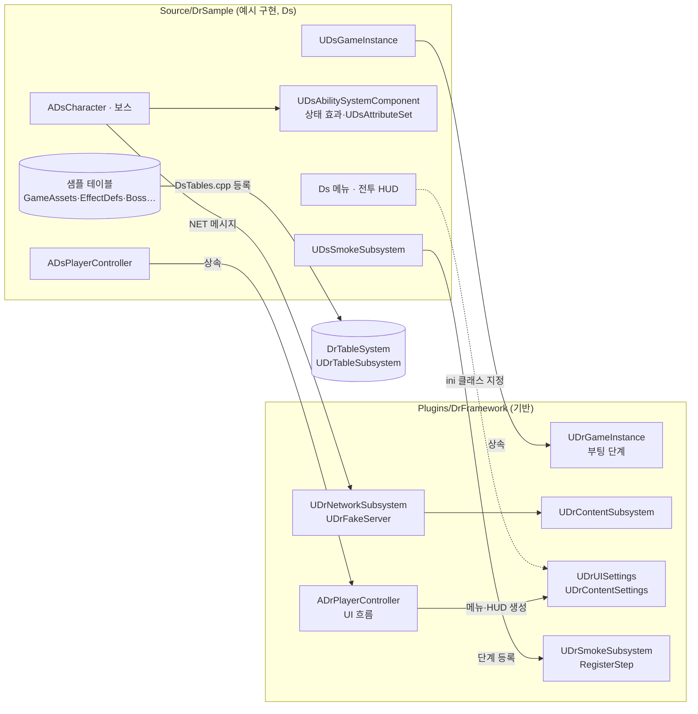

# DrSample

[DrFramework](https://github.com/ldnjin81/DrFramework) 위에 게임을 얹는 방법을 보여 주는 **샘플 프로젝트(참고 구현)**다(UE 5.8, 접두사 `Ds`). 기반 클래스를 상속·설정해 근접 전투 게임 한 판(이동·회피·공격·피격·적 추적·사망, 보스 패턴, 메뉴·HUD)을 만든다.

- 게임은 이 샘플을 **포함하지 않고 참고만 한다.** 게임에는 DrFramework(권장: DrTableSystem)만 넣고, 장르 코드는 이 샘플을 보며 자기 모듈에 자기 접두사로 만든다. 필요한 부분을 복사해 출발점으로 삼아도 된다.
- 기반 명세: [DrFramework 설계 명세서](https://github.com/ldnjin81/DrFramework/blob/main/Docs/FRAMEWORK_FOR_AI.md) · 샘플 명세: [샘플 설계 설명서](Docs/SAMPLE_DESIGN.md) · 콘텐츠 상태: [샘플 인계 노트](Docs/SAMPLE_NOTES.md)
- 의존: `DrSample → DrFramework`, `DrSample → DrTableSystem`. 두 플러그인은 git 서브모듈이다.

```powershell
git clone --recurse-submodules https://github.com/ldnjin81/DrSample   # 이미 받았으면: git submodule update --init
```

## 구성

| 위치 | 역할 |
| --- | --- |
| `Plugins/DrFramework` | git 서브모듈 — [DrFramework](https://github.com/ldnjin81/DrFramework) 플러그인(`unreal/DrFramework`) |
| `Plugins/DrTableSystem` | git 서브모듈 — [DrTableSystem](https://github.com/ldnjin81/DrTableSystem) v0.10.0(플러그인은 `unreal/DrTableSystem`) |
| `Source/DrSample` | 예시 구현(접두사 `Ds`, `DRSAMPLE_API`), PIE 검증 |
| `Source/DrSample/Tables` | 샘플 테이블 스키마·열거형·원본 데이터(`Schemas`·`Enums`·`Data`) |
| `Content/DrSample`, `Content/Data` | 샘플 BP·맵·입력·몽타주·DataAsset, 구운 테이블 |
| `Tools` | 테이블 생성(`gen_tables.ps1`), Lyra 콘텐츠 가져오기, 샘플 콘텐츠 생성 |

### 기반과 샘플이 나눠 맡는 것

| 영역 | 플러그인(기반) | 샘플(예시 구현) |
| --- | --- | --- |
| 게임 인스턴스 | 부팅 단계 실행기(`GetBootSteps`·`ExecuteBootStep`·`CompleteBootStep`) | 연결→Ping→로그인→프로필 단계 |
| 게임 모드 | `ADrGameMode`(폰 미지정) | `ADsGameMode`(캐릭터·컨트롤러 지정), 타이틀 게임 모드 |
| 사용자 설정 | 저장 틀과 `ApplyGameSettings` 훅 | SFX·Voice·Music 음량 |
| 네트워크·가짜 서버 | 요청 Id·타임아웃·지연 큐, `RegisterHandler(Id, 처리기)` | 메시지 ID(`DsMessages`), 로그인·프로필 처리기 |
| 콘텐츠 | `UDrContentBase`·서브시스템, `UDrContentSettings` 등록 목록 | `UDsPlayerProfileContent` |
| 테이블 | 없음(DrTableSystem 권장) | GameAssets·EffectDefs·BossPhase·BossAttack·EffectExtensions, 등록 1곳 |
| GAS | 없음 | ASC(틱 어빌리티·상태 효과·쿨다운), 속성 세트, 스탯 공식, 피해 GE, 기력·포이즈, 근접·회피·막기 |
| 캐릭터 | 없음 | `ADsCharacter`(ASC·입력·카메라·락온·전투 FX), 보스 |
| UI | 화면 층, 메뉴 동작, HUD 기반, `UDrUISettings`, 컨트롤러 UI 흐름 | 타이틀·일시정지·설정 메뉴, 글래스 버튼, 전투 HUD·표시 모델 |
| 검증 | 단계 등록형 스모크, 성능 표본 통계 | 스모크 단계·성능 측정 경로, PIE 전투 테스트 |
| 전투·엔카운터·오디오·태그 | 없음 | 전부 |

### 관계



## 확장 지점

| 확장 지점 | 기반 동작 | 게임이 하는 일 |
| --- | --- | --- |
| `UDrGameInstance::GetBootSteps`·`ExecuteBootStep` | 빈 단계 목록 | 연결·인증·초기 데이터 단계 |
| `UDrFakeServer::RegisterHandler` | Ping만 응답 | 메시지 ID별 처리기 |
| `UDrContentSettings.ContentClasses` | 빈 목록 | 콘텐츠 클래스 등록 |
| `UDrUISettings`(프로젝트 설정 "DrFramework UI") | 비어 있으면 화면을 열지 않음 | 메뉴·HUD 클래스, 입력 매핑, 타이틀·게임 맵 |
| `ADrPlayerController` 훅 | `OnHUDCreated`·`OnPawnChanged`·`CanOpenPauseMenu`·`RequestRestart` | 게임 HUD 연결, 메뉴 허용 조건, 재시작 |
| `UDrSmokeSubsystem::RegisterStep` | 단계 없음 | 게임 시나리오 단계 |

## 데이터 테이블 (샘플, DrTableSystem)

DrFramework는 테이블을 갖지 않는다. 샘플이 DrTableSystem으로 모든 테이블을 소유한다.

```powershell
.\Tools\gen_tables.ps1 -DrTable <drtable.exe>     # Source/DrSample/Tables → TableData/Generated (--prefix Ds)
# DrSampleEditor 빌드 후 (클래스 이름이 바뀌었으면 -Force)
UnrealEditor-Cmd DrSample.uproject -run=DrTableBake -Input=$env:TEMP\DrSample-DrTable\sample\client -Out=/Game/Data -nullrhi -unattended
```

- 생성 C++(`TableData/Generated`)는 손으로 고치지 않는다. 스키마를 고치고 다시 생성한다.
- drtable은 모듈 API 매크로를 붙이지 않으므로 `gen_tables.ps1`이 생성 직후 행 구조체를 `DRSAMPLE_API`로 내보낸다. 다른 모듈이 `FDs…Row::Find`를 링크하려면 필요하다.
- 스키마 해시가 바뀌면 다시 굽는다. 옛 에셋이면 런타임에 "Schema mismatch, re-bake required"가 난다.

## 샘플 실행

저장소에는 코드, 샘플 BP·맵·입력·몽타주·DataAsset과 구운 테이블이 들어 있다. Epic 원본 메시·시퀀스·머티리얼은 각자 설치한 **Lyra Starter Game**에서 가져온다. 원래 패키지 경로(`Content/Characters/`, `Content/Effects/`, `Content/PhysicsMaterials/`)로 복사하며 이 폴더는 Git에서 제외한다.

1. UE 5.8.2에서 `DrSampleEditor Win64 Development`를 빌드한다.
2. 에디터를 닫고 Lyra 콘텐츠를 가져온다. 도구는 고정 목록의 115개 에셋을 복사하고 복사본에서 Lyra 전용 참조를 정리한다. Lyra 프로젝트는 바꾸지 않는다.

```powershell
.\Tools\import_epic_content.ps1 -LyraPath 'C:\Project\EpicSample\LyraStarterGame'
```

3. `L_DrSample` 맵에서 PIE를 시작한다. 샘플 에셋을 다시 만들려면 `UnrealEditor-Cmd DrSample.uproject -run=pythonscript -script=Tools/build_sample_content.py -EnablePlugins=PythonScriptPlugin -nullrhi -unattended`를 실행한다(이미 있는 에셋은 재사용하므로 부모 클래스를 바꿀 때는 해당 에셋을 지우고 실행).

| 동작 | 키보드·마우스 | 패드 |
| --- | --- | --- |
| 이동·시점 | WASD·마우스 | 왼쪽·오른쪽 스틱 |
| 달리기 | 왼쪽 Shift | 왼쪽 스틱 누르기 |
| 기본·강공격 | 마우스 왼쪽·오른쪽 | 오른쪽 숄더·트리거 |
| 회피·점프 | 왼쪽 Alt·Space | 오른쪽·아래쪽 페이스 버튼 |
| 락온·막기 | 휠 누르기·Q | 오른쪽 스틱 누르기·왼쪽 숄더 |

플레이어 Manny와 적 Quinn이 이동·대시 회피·근접 공격·추적·피격·사망을 보여 준다. 사운드·별도 FX·메뉴 콘텐츠는 없어서 해당 기능은 대체 동작을 쓴다.

## 검증

UE 5.8.2 기준 현재 상태:

| 검증 | 결과 |
| --- | --- |
| `DrSampleEditor Win64 Development` 빌드 | 성공 |
| `Automation RunTests DrFramework+DrSample` | 72/72 성공(기반 5, 샘플 67, PIE `DrSample.PIE.BasicCombat` 포함) |

플러그인 단독 검증은 [DrFramework 저장소](https://github.com/ldnjin81/DrFramework)의 `Tools/verify.ps1`이 맡는다.

```powershell
& '<UE_5.8>\Engine\Binaries\Win64\UnrealEditor-Cmd.exe' '<저장소>\DrSample.uproject' `
  '-ExecCmds=Automation List; Automation RunTests DrFramework+DrSample' `
  '-TestExit=Automation Test Queue Empty' -nullrhi -unattended -log
```

기반 테스트는 게임 데이터·다른 플러그인 없이 통과해야 한다. 재구성 전 64개 테스트의 새 이름은 [task65-test-map.csv](Docs/task65-test-map.csv)에 있다.

샘플 진단 진입점:

| 진입점 | 용도 |
| --- | --- |
| `Ds.Net.Ping`, `Ds.Profile.Request` | 연결과 프로필 요청 확인 |
| `Ds.Net.SetLatency`, `Ds.Tables.Reload` | 네트워크 조건 변경·테이블 재로드 |
| `DrTable.Status`, `DrTable.Reload` | 테이블 등록·로드 상태(DrTableSystem) |
| `-DsAutoNetSmoke` | 부팅·네트워크 흐름 점검 |
| `-DsSmokeTest`, `-DsPerfCapture` | 패키지 스모크·성능 측정 |
| `-DsCaptureAudio` | 소리 검증 지원 |

## 이름 규칙

- 기반 클래스·구조체·열거형은 `Dr`, 샘플은 `Ds`, 다른 게임은 자기 접두사를 쓴다. 기반 이름은 게임 쪽에서 바꾸지 않는다.
- 테스트 이름은 기반 `DrFramework.*`, 샘플 `DrSample.*`.
- 게임플레이 태그(`State.*`·`Ability.*`·`Data.*`)는 샘플 소유다. 기반은 태그를 정의하지 않는다.
- 샘플 구조가 바뀌면 같은 작업에서 샘플 설계 설명서와 이 README를 고친다. 기반을 바꿔야 하면 DrFramework 저장소에서 고치고 서브모듈을 올린다([AGENTS.md](AGENTS.md)).
